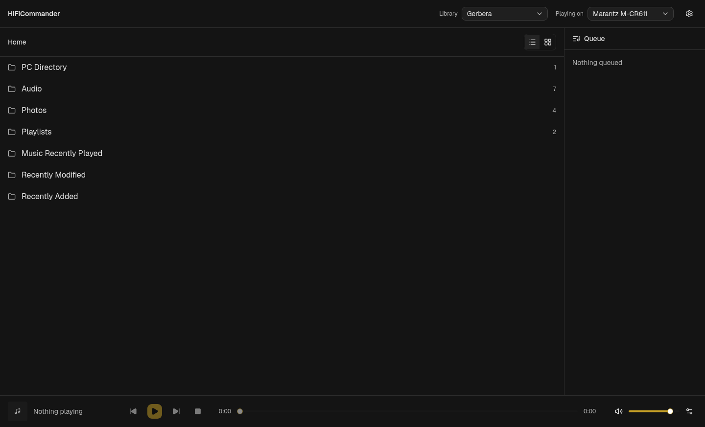
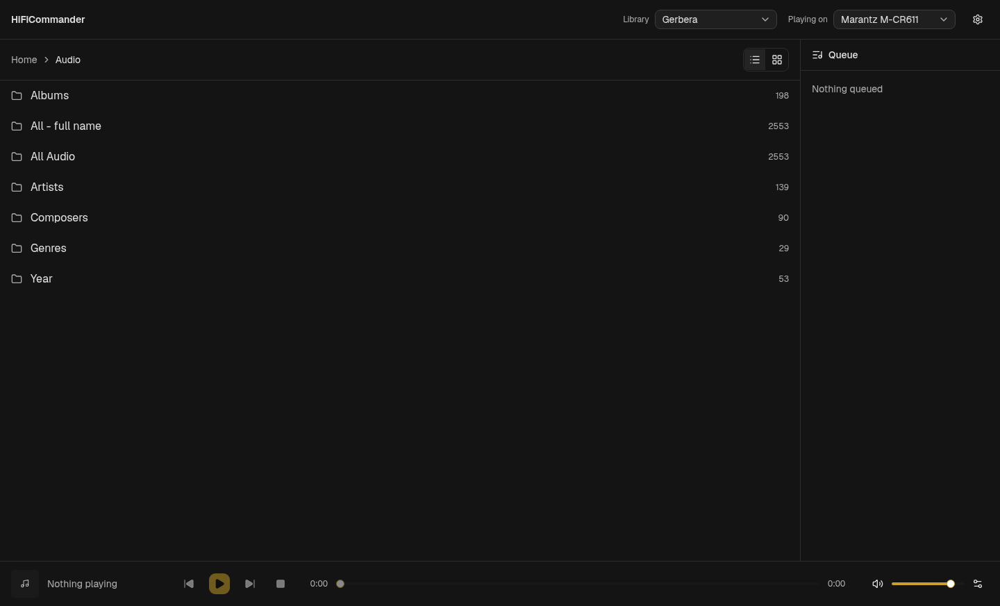
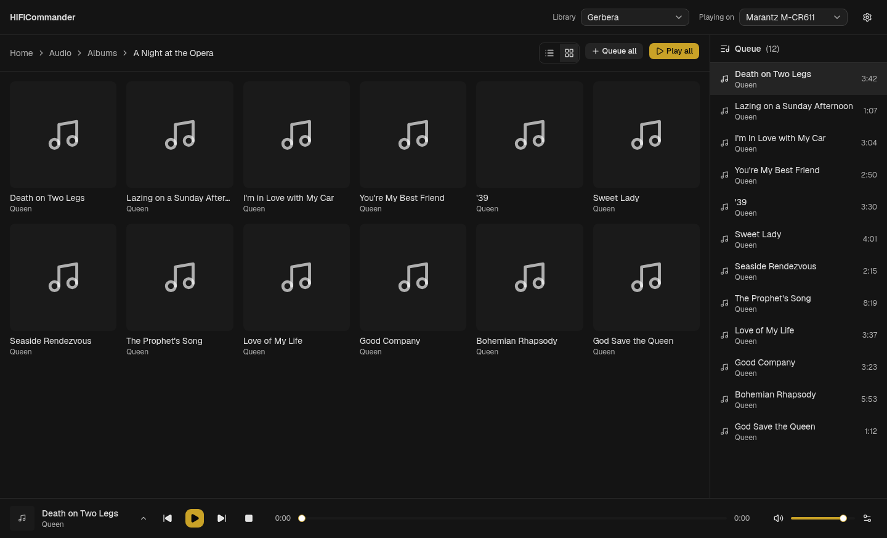
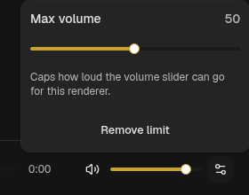

# HiFiCommander

Web UI + API to browse UPnP/DLNA media servers and control renderers on your
LAN.

**This is not a media server.** It doesn't store or serve files — it's a
*control point*: it discovers a MediaServer and MediaRenderer already on your
network via SSDP and gives you a UI to browse the server's library and drive
the renderer (play/pause/seek/volume/queue). You still need something
actually serving your media, e.g. [Gerbera](https://gerbera.io/) or
[MiniDLNA](https://sourceforge.net/projects/minidlna/) — this app just talks
to it.

## Screenshots

|                                          |                                                |
| ---------------------------------------- | ---------------------------------------------- |
|    |  |
|  |  |

## Features

- **Discovery** — finds servers/renderers via SSDP, and also catches devices
  that ignore searches (via their announcements, their own SSDP traffic and
  mDNS). Found devices are remembered, so a new IP is picked up on its own.
  A description URL can still be added by hand as a last resort.
- **Browse** — folder/album/artist browsing over ContentDirectory, with list
  and grid views, filtering, and an alphabet jump strip for long lists.
- **Playback control** — play, pause, seek, and a queue with auto-advance
  (polls transport state and moves to the next track when one ends).
- **Volume limiting** — cap the max volume a renderer's slider can reach,
  independent of the renderer's own volume control.
- **Live updates** — device list and queue state push over WebSocket.

## Requirements

You need an existing UPnP MediaServer (Gerbera, MiniDLNA, Plex's DLNA server,
etc.) and at least one UPnP/DLNA MediaRenderer on the same LAN.

## Running it

### Node

```bash
npm install          # installs server + web workspaces
npm run dev           # server on :3000, web dev server with hot reload
# or, for a production build served by the API:
npm start
```

### Desktop app (Linux)

```bash
npm run desktop:install
```

Builds an Electron app and installs it to `~/.local/share/hificommander` with
a launcher entry. The server runs inside the app; closing the window hides it
to the tray so playback keeps going. Settings (remembered devices, pins,
volume limits) live in `~/.config/HiFiCommander`.

`npm run desktop` runs it straight from the repo. Only one copy can run at a
time, since discovery needs UDP port 1900.

## Discord rich presence

Optional: shows the current track as your Discord activity. Create an
application at <https://discord.com/developers/applications>, copy its
Application ID into `.env` as `DISCORD_CLIENT_ID` (see `.env.example`),
and restart. Works with the official client and with Vesktop/arRPC (enable
Rich Presence in Vesktop settings). For an image on the activity card,
upload an art asset named `cover` under the application's Rich Presence
assets. Presence is skipped entirely when `DISCORD_CLIENT_ID`
is unset or Discord isn't running.

## Pinning a device manually

If a device never shows up, open Devices and use "Add by URL" with its
description XML URL.
